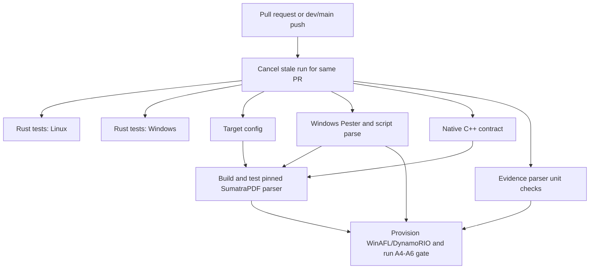

# Immutable GitHub Actions references (#68)

All external `uses` references in `repository-checks.yml` are pinned to full
commit IDs rather than mutable major-version tags. This is an incremental
supply-chain change that does not depend on the worker journal or native launch
acceptance. It does not complete #68 or change repository branch protections.

The following official action `v4` refs were resolved through GitHub on
19 October 2026. Each object was a commit, GitHub reported its commit signature
verified, and `action.yml` was fetched successfully at that exact revision.
This establishes the observed upstream identity, not an audit of the action's
bundled dependencies or a guarantee against an upstream compromise.

| Action | Pinned commit | Official source |
| --- | --- | --- |
| `actions/checkout` | `11d5960a326750d5838078e36cf38b85af677262` | [commit](https://github.com/actions/checkout/commit/11d5960a326750d5838078e36cf38b85af677262) |
| `actions/upload-artifact` | `ea165f8d65b6e75b540449e92b4886f43607fa02` | [commit](https://github.com/actions/upload-artifact/commit/ea165f8d65b6e75b540449e92b4886f43607fa02) |
| `actions/download-artifact` | `d3f86a106a0bac45b974a628896c90dbdf5c8093` | [commit](https://github.com/actions/download-artifact/commit/d3f86a106a0bac45b974a628896c90dbdf5c8093) |
| `actions/cache` | `0057852bfaa89a56745cba8c7296529d2fc39830` | [commit](https://github.com/actions/cache/commit/0057852bfaa89a56745cba8c7296529d2fc39830) |

The existing workflow's jobs, triggers, job dependencies, command assertions,
timeouts, token permissions, checkout credential settings and artifact paths are
preserved. Formatting runs earlier and superseded PR runs can be canceled;
canceled runs do not supply acceptance evidence. This change does not restore any native gate
removed by an earlier revert; a green workflow still proves only the checks
that actually ran on its exact commit.

## Updating and reviewing

Dependabot is configured to propose weekly GitHub Actions updates against
`dev`, with at most five open update PRs. This configuration must reach the
repository's default branch for GitHub to activate it; a feature PR or a merge
only into a non-default integration branch does not activate scheduling.
The repository currently uses `main` as its default branch. See
[GitHub's configuration requirements](https://docs.github.com/en/code-security/concepts/supply-chain-security/about-the-dependabot-yml-file).
No automatic approval or merge is configured.

For each proposed change, inspect the official upstream commit and release
notes, the precise SHA diff, action runtime compatibility and artifact contract.
Require existing CI and human review. Never replace a pin with a moving tag to
work around a resolution or execution failure. A verified commit signature
does not substitute for reviewing changed action code.

For a resolution regression, disable affected starts and propose a normal PR
back to a previously reviewed **full commit ID**. Do not remove required jobs,
weaken assertions, broaden permissions or silently ignore a failing action.
Use the established `dev`/`main` release process to deliver dependency updates.

## Workflow map

All six independent checks start together. The real parser job waits for its four
prerequisites; the longer native instrumentation gate starts only after verified
parser artifacts are available. Every check remains required by this workflow.

## Validation and remaining work

Validation resolves all four upstream refs and their exact action metadata,
parses the edited YAML, checks every remote action has a 40-character hex SHA,
and checks that the native jobs, job inventory, permissions and triggers are
unchanged. Rust job commands are retained with formatting moved before dependency
fetch/test. The cache action is the only new workflow dependency.
Configuration-only validation is not a new native execution claim.

## CI turnaround changes

PR concurrency groups include workflow, event and PR identity. A new commit can
cancel an obsolete run of the same PR; unrelated PRs and integration `dev`/`main`
pushes are not canceled by this rule. Only a complete successful run at the
reviewed commit counts as acceptance.

Formatting runs before Cargo downloads and compilation, returning formatting
errors earlier. The Rust cache stores Cargo registry/git source data and the workspace `target`
directory, keyed by runner OS/architecture, Cargo.lock, the pinned toolchain and
commit. Later commits restore the latest compatible cache and save a new one.
Cargo still validates fingerprints and rebuilds changed inputs. No native
SumatraPDF binary, Git credential, Cargo config or private corpus is cached.
Locked fetch, compilation, tests and Clippy still run; cache hits never
substitute for verification. The restore prefix is limited to the same runner,
lockfile and toolchain. The cache is a performance hint, not a trust or
correctness boundary.

The journal PR's exact-commit run 39199281160 measured about 298 seconds for
the real-parser job and 802 seconds for native instrumentation/acceptance.
Those required jobs dominate the critical path. This update targets duplicate
runs, dependency downloads and repeat Rust compilation; the new exact-commit
run will show whether it helps. The native Windows gate remains the main
wall-clock cost. Cold caches can add overhead. No native test duration,
execution threshold or assertion is reduced.

#68 still requires effective branch-protection verification, security/dependency
scanning, tool provenance and SBOM/license review, later lifecycle/API gates,
exact-commit native CI and reviewed merges. PowerShell module versions, runner
images, tool installers and upstream downloads are not all pinned by this PR.
